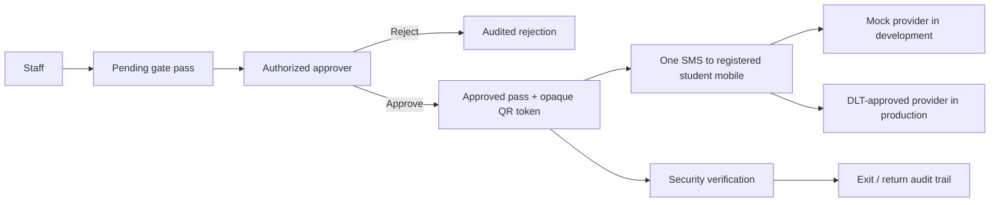
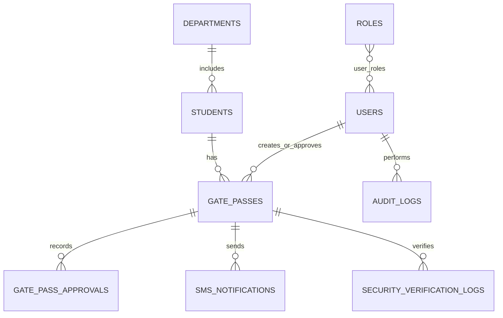

# Architecture and operations

## Workflow

## Security rules

- Passwords use Werkzeug password hashing; raw passwords and SMS credentials are never stored in the database.
- Flask-WTF CSRF protection applies to state-changing browser forms.
- Flask-Limiter protects the login endpoint. Production requires Redis-backed rate-limit storage.
- Authorization is enforced by backend role decorators, not navigation visibility.
- QR codes contain only a random verification URL/token, never student details.
- The student SMS contains a unique pass reference, but the displayed message is not trusted as proof; security verifies that reference or QR token against the approved, unexpired, unused pass in the system.
- Parent/guardian contact data is administrative only and is never an SMS recipient for a gate pass.
- The gate-pass request, decision, notification record, and security actions have auditable database records.
- Gate passes remain approved if notification delivery fails; failure is visible in notification history.

## Entity relationships

## SMS provider handoff checklist

1. Obtain the provider API documentation and a designated technical contact.
2. Confirm DLT entity ID, DLT template ID, transactional route, delivery-report method, and approved sender ID.
3. Confirm the college authorization for `CP-MRITPR-S` and configure that exact sender header for the transactional route.
4. Implement and test the provider adapter in `app/services/sms_service.py` with sandbox credentials.
5. Store production credentials in deployment secrets/environment variables and perform a controlled live-delivery test.
